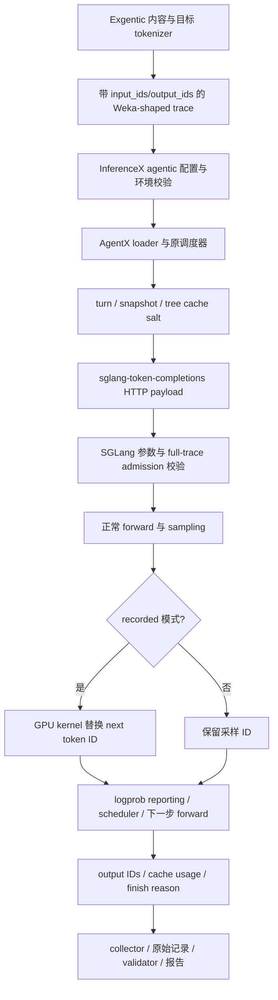

# AgentX Token Replay：项目复盘与源码学习

这份笔记解释我们已经做过的工程，以及其中的推理系统原理。整理日期：2026-11-10；核对源码版本：`7583033`。自然 L1 的运行状态补记至 2026-11-17；本文是学习材料，不是新的审阅接受记录。

先记住项目的一句话目标：**让 AgentX 回放记录里的对话时，服务端沿着记录里的 token 轨迹继续做真实模型计算，使后续 prompt 有机会复用对应的 KV 前缀。**

本次覆盖 InferenceX 入口、AgentX harness、SGLang 补丁、数据资格审查、缓存隔离、Dense/MoE 实验、生命周期、统计和证据交付。不展开整个 InferenceX、Transformer 的矩阵推导、CUDA 底层或尚未执行的 B2 实现。依赖项目的代码以补丁保存，不全部内嵌在本仓库；实际部署字节另有归档。

## 0. 我们究竟完成了什么

| 工作 | 已有事实 | 结论边界 |
| --- | --- | --- |
| 原入口接入 | 通过原 `infx.bench agentic` → `agentx profile` 路线接入 token 数据 | 不是用独立小客户端替代整个 AgentX 的方法学 |
| 服务端 token replay | 正常 forward、正常 sampling 后替换 token，替换发生在后续计算之前 | 没有跳过模型计算；不承诺浮点 KV 逐 bit 相同 |
| 调度与隔离 | 验证 warmup、snapshot、spawn/join、reset、tree cache salt | 合成 DAG fixture 的覆盖不能冒充原始数据的真实 DAG |
| Dense 正式矩阵 | 36 cells，25755 profiling requests、1716 warmup requests，无 errors/skips/cancellations | 闭环调度下实际请求混合会改变，必须保留分母 |
| Dense 独立正确性 | 32 sessions、447 requests，从头执行的 reference 全部 output IDs 精确一致 | 不等于每次性能实验都逐 ID 审计过 |
| 机制开销 | 固定 32 prompts、greedy、HTTP 边界、c1/c4/c8 满足预设 3% 上界 | 不是完整 AgentX 的通用 overhead 保证 |
| Weka 默认路线 | 独立 64K YaRN 配置完成；保留 16K 无合格 trace 及中间失败 | hash-only 数据不能还原真实回复；不跨数据集当配对基线 |
| MoE | 21 sessions、308 requests/内容类型；性能、路由、双 rank 诊断分别记录 | 路由分布变了，不代表吞吐显著变快或计算时间存在因果变化 |
| 受控 L1 | 同一请求 pause/retract/resume，641/641 output IDs 一致 | 仅受控触发，不是自然 KV-pressure 覆盖 |
| L2 / L3 | 混合 batch filter/merge；活动取消、后端 abort、退出 batch 与后续请求通过 | 原 receipt 和修正后的只读 recheck 都保留 |
| 自然 L1 | 2026-11-17 新冻结 run 的 c4/c8 均完成，无 driver failure；L2/L3 PASS | 未观察到同请求自然 `kv_full` 链；自然覆盖仍 UNCOVERED |
| B2 | 有条件的 instrumented AgentX c1 fixed-cohort 计划 | DEFERRED，没有扩大 overhead claim |
| 审阅与交付 | Codex review 完成但 provisional；确定性检查有记录 | Claude unavailable；不是双审通过，无 upstream formal acceptance 或 official benchmark score |

这些工作由会话中的工具与审阅流程完成。下面从基本概念开始，逐步说明各层代码为什么存在、如何配合，以及结果意味着什么。

权威结果集中在 [主报告](../../inferencex-e2e/docs/token-replay-meeting-review.md)、[实验跟踪](../../refine-logs/EXPERIMENT_TRACKER.md)、[审阅总结](../../refine-logs/REVIEW_SUMMARY.md)。本笔记对已有记录作解释，本次没有重新执行 GPU 实验。

## 1. 前置知识：只补当前用得到的

| 概念 | 通俗解释 | 在这里为什么需要 |
| --- | --- | --- |
| token / tokenizer | 模型处理的是整数序列；一个 token 不一定等于一个汉字或单词 | 同样的显示文本不一定有完全相同的 token 边界 |
| chat template | 把角色、工具调用和消息排成模型需要的格式 | 工具参数被重复 JSON 编码就会改变输入 |
| embedding | 用 token ID 查出模型向量 | replay 的 ID 仍正常进入 embedding lookup |
| prefill | 一次处理 prompt，建立对应 KV | 长 prompt 的主要前置工作 |
| decode | 自回归地产生后续 token | 每一步的 token 会影响下一步计算 |
| sampling / greedy | 从概率分布选 token；greedy 取最大值 | replay 仍先执行原采样路径，再替换选出的 ID |
| KV cache / prefix cache | 保存注意力历史；相同前缀可复用已算部分 | 前缀 token 漂移会破坏后续共享 |
| batch / scheduler | 动态把多个请求安排到同一次计算 | 请求完成、加入、取消后，行号与元数据必须继续对应 |
| request ID / event | 请求身份与后端发生的动作 | 判断是否同一个请求真正 retract 后恢复 |
| wall time / GPU time | 用户等待的经过时间 / GPU 上某段工作时间 | 两者不能混作一个指标 |
| seed / hash | 控制伪随机选择 / 标识具体字节 | seed 固定不能取代模型、数据和代码版本冻结 |

最低前置能力：能读 Python 的 list/dict、函数、异常、文件读写；知道 HTTP 请求与 JSON；会用终端进入目录。暂时不需要先学完全部深度学习。

## 2. 一次请求怎样穿过系统



这是模块及事件顺序图，并非所有箭头都是同一 Python 进程里的直接函数调用。AgentX 与模型服务通过 HTTP 通信，SGLang 内部还有调度与异步执行。

假设记录回复为 `[10,20,30]`，模型本来会选 `[10,99,...]`。只在客户端把 `99` 显示成 `20`，模型下一步仍沿 `99` 计算。我们的替换发生在服务端：第二步选出的 `99` 被改成 `20`，后续 forward 使用 `20`。这样模型内部沿着记录轨迹走，后续包含 `[10,20,30]` 的 prompt 才能匹配对应前缀。

这里的“recorded”有两种来源，要分清：内容实验使用目标 tokenizer 编码的记录回复；固定 32-prompt 开销实验使用先捕获的目标模型 greedy 回复。两者服务于不同问题。

## 课程 01：一条记录怎样成为可发送的请求

状态：已展开概念与源码路线。读完应能解释：数据哪里来，为什么不能直接使用源模型的 token IDs。

主链：固定 source revision → 候选 session → 模板转换与目标 tokenizer → 合格连续窗口 → token trace 与 provenance。

1. 阅读 [prepare_exgentic.py](prepare_exgentic.py) 的 `encode_span`：输入源 span 和目标 tokenizer；输出目标模型的 prompt/response IDs。工具调用参数字符串需要先转回 JSON 对象再交给模板。
2. 阅读 `qualify_session`：输入编码后的会话；判断完整请求是否适合上下文预算，选择连续窗口。不是为了让实验通过而截断超长请求。
3. 阅读 `source_candidates`、`prepare`、`make_weka`：候选顺序与 seed 决定可复现选择，输出会话文件和 manifest。看 [Dense manifest](evidence/exgentic-dense-manifest.json) 的来源、窗口、排除原因。
4. 在 [harness patch](agentx-harness-v1.0.13.patch) 搜索 `WekaTokenRequest.validate_token_pair` 和 `_attach_recorded_tokens`：确认成对 IDs 非空、长度与 `in/out` 一致，DAG 重建后按原 source indices 找回正确请求，复制 IDs 到 `Turn`。

关键事实：Exgentic 固定 revision 为 `4b8ad4ab198438e5a170f9171c19c6a2cf7c1814`。Dense 检查 46/1959 个候选，得到 32 sessions、447 requests；不能声称全部候选均审过。最长 prompt+output 为 16143，符合 16K 条件。MoE 检查 128 candidates，得到 21 sessions、308 requests；旧模板不能忠实表达的 tool spans 被排除。

以前 Dense `-01` 对 327/447 个输出的工具参数发生 double encoding。修正数据为 `exgentic-dense-02`；旧数据作为负面证据保留。这个错误说明：字段都是合法 JSON，也可能在语义格式上错一层。

Weka public 固定 revision 为 `23f152f6f0f9399a85901b89a6458def0ef16729`，只有 hash 信息；hash 能帮助重建共享结构，不能反解出原始自然语言或真实回复 IDs。不要把重新合成的文本称为原文。

选读：[audit_dense_corpus.py](audit_dense_corpus.py)、[check_target_template.py](check_target_template.py)。暂缓统计比较，课程 05 再看。

## 课程 02：怎样接回原 AgentX 路线

状态：已展开概念与源码路线。读完应能解释：为什么这不是一个另起炉灶的小 replay 客户端。

主链：环境配置 → `ReplayConfig` → 固定 harness 环境 → `agentx profile` → 原 scheduler → HTTP → 原结果收集。

1. 阅读 [agentic/replay.py](../../inferencex-e2e/infx/bench/agentic/replay.py) 的 `ReplayConfig.from_env`：检查 token trace、mode、wheel/hash 必须配套；`AGENTX_NUM_SESSIONS` 有适用范围和并发约束。
2. 阅读 [agentic/venv.py](../../inferencex-e2e/infx/bench/agentic/venv.py) 的 `bootstrap`：核对 wheel SHA-256 和 harness 1.0.13 身份，再安装到专用环境。源码相似不代表 wheel 字节相同。
3. 回到 `replay_argv`：默认走 public dataset；显式 token trace 才走本地 `weka_trace` 和 `sglang-token-completions`，seed 为 42，并标记 unsafe override。
4. 阅读 [agentic/run.py](../../inferencex-e2e/infx/bench/agentic/run.py) 的 `execute`、`_score`：执行 harness，随后调用结果收集和校验。追到 harness 边界时切换到补丁，不能假设依赖源码就在本仓库。
5. 在 harness patch 看 `CompletionsEndpoint.format_payload` 与 `SGLangTokenCompletionsEndpoint`：完整 prompt IDs 绕过 chat rendering；仅 recorded 模式发送 `replay_token_ids`；一 token warmup 也只发送一 token 的 replay 输出。

三个开关：`AGENTX_TOKEN_TRACE` 指定本地 token 数据；`AGENTX_REPLAY_MODE=generated|recorded` 选 arm；`AGENTX_HARNESS_WHEEL` 与 `AGENTX_HARNESS_SHA256` 固定依赖字节。两 arm 使用相同 prompt 和输出长度，generated 正常生成，recorded 强制记录轨迹。

没有 token 扩展时保留原 public 路线。本地扩展结果包含 `submission_valid=false`，表示本地实验，不是官方提交得分。

Warmup 包括 snapshot primer 和每 lane 10 次加速 live replay；后者无 idle delay、每请求只生成一 token，但完整 prompt 的 prefill 仍有成本。现有 37 次边界审计未发现 warmup HTTP 与 profiling HTTP 重叠；这不等于无 GPU 干扰或 warmup 免费。删除 warmup 会改变初始缓存状态。

原入口 acceptance 的 synthetic DAG fixture 完成 198 profiling + 42 warmup 请求，检查全部 240 个 wire prompt/replay/final output；覆盖 tree salt、join、reset 和 child idle gap。真实 Exgentic 缺失的 DAG 不会被凭空补成真实拓扑。

选读：[check_harness.py](check_harness.py)、[check_dag_events.py](check_dag_events.py)、[audit_phase_boundary.py](audit_phase_boundary.py)。暂缓服务端 kernel，下一课再看。

## 课程 03：为什么替换一个整数也需要 GPU 工程

状态：已展开概念与源码路线。读完应能解释：替换位置、内存组织与 batch 行映射。

主链：HTTP 参数 → tokenizer/scheduler admission → `SamplingBatchInfo` → `TokenReplayBatch` → 正常采样 → 替换 → 下一步计算。

以下依赖路径都在 [SGLang patch](sglang-v0.5.10.patch) 内，应用到 SGLang `1519acf` 基线；实际部署源另见归档。

1. `entrypoints/openai/protocol.py`、`serving_completions.py`：接收严格整数列表，将参数传入服务内部。
2. `sampling/sampling_params.py`：校验非空、词表范围、`max_new_tokens == len(replay_token_ids)`；要求 ignore_eos、没有 stop 条件；不支持 constrained decoding 等组合。
3. `managers/tokenizer_manager.py` 和 `scheduler.py`：输入加完整输出必须满足预算。对 replay 要显式拒绝，不能走普通生成的静默缩短逻辑；也拒绝 speculative decoding 和 custom logit processors 等未支持组合。
4. `sampling/sampling_batch_info.py`：随 batch 构造、filter、merge 管理 replay 状态。
5. `sampling/token_replay.py`：`TokenReplayBatch.from_requests` 将不同长度的输出拼成一个 packed GPU tensor；每行 metadata 为序列地址、长度、原 prompt 长度；普通请求没有 replay view。
6. `layers/sampler.py`：正常 forward 和 sampling 已完成后调用 `apply`，随后才附加 logprobs、交给后续调度计算。

替换 kernel `_replace_sampled_tokens` 的索引为：

```text
step = position - original_prompt_length + 1
当 0 <= step < recorded_length 时，把 sampled[row] 改为 recorded[step]
```

例如 prompt 长度 5，position 为 4 时，step=0，对应第一颗输出 token。恢复请求也必须沿绝对位置找到后续正确 ID，不能因 batch 重建把游标重置到输出开头。

`filter` 选择仍活跃的 views 和 metadata；`merge` 合并元数据，并为普通请求填零 metadata。不会在每次 decode 复制整条回复。最后一个 replay 请求退出时，状态可回到 `None`。小 view 可能仍持有整个 packed buffer，所以“剩余 token 字节变少”和“allocator 已释放多少”是两回事。

固定存储 fixture 的 kernel 约 0.98–1.17 微秒/次，只是组件计时；真实成本还有 JSON、传输、staging、元数据维护和冷启动。单独 allocator probe 的 live allocation 最大约 8.7 KB、peak delta 最大约 9.7 KB，只覆盖所选 response，不是整个模型服务的显存增量上限。

选读：[check_engine.py](check_engine.py) 的 `check_validation`、`check_kernel`、`check_engine`，以及 [check_storage.py](check_storage.py)、[profile_replay.py](profile_replay.py)。暂缓 retract，课程 07 专门讲。

## 课程 04：缓存为什么会“看起来命中，实际上串会话”

状态：已展开概念与源码路线。读完应能解释：cache salt 必须真的进入服务端 key。

主链：tree 实例 → harness cache-bust marker → payload `cache_salt` → SGLang `extra_key` → prefix-cache 隔离与命中。

1. 在 harness patch 的 `workers/worker.py` 看 `cache_salt` 如何来自 `credit.cache_bust_marker`。同一树的 parent/children 应共享，独立 tree 实例应不同。
2. 在 SGLang patch 的 scheduler 创建 `Req` 处看 `extra_key=recv_req.extra_key`。这是已修复的关键传递，不能因为 wire 中有 salt 就认为隔离生效。
3. 阅读 [check_cache_salt.py](check_cache_salt.py) 的 `check_cache_salt`，理解相同 prompt、A/B/A salt 的三次请求为什么是隔离 witness。

实际修复前 cached tokens 为 `[0,63,63]`，B 错用了 A 的缓存；修复后为 `[0,0,63]`，B 独立，第三次 A 可以复用第一次 A。早期失效 fixture 保留，不能挑修复后的日志假装问题从未发生。

cache hit 表示复用了某些前缀 token 的计算，不代表输出语义更正确。resident、protected/non-evictable、allocated KV 也不是同一个数。报告区分可驱逐前缀、保护前缀和包括进行中 suffix 的已分配 KV。

选读：[check_entry_log.py](check_entry_log.py)、主报告的 Original-path acceptance。暂缓吞吐归因，下一课再看。

## 课程 05：Dense 实验到底比较了什么

状态：已展开概念与源码路线。读完应能解释：正确性、缓存效果、机制开销为什么是三种实验。

主链：冻结 spec → guard → 新 server → warmup → 固定 admission 窗口 → drain → phase-separated summary → 配对统计。

1. 阅读 [dense-formal-01.spec.json](dense-formal-01.spec.json)：2 modes × 3 concurrencies × 2 capacities × 3 repeats = 36 cells。context=16384；KV capacities=131072/16384；每 cell profiling admission=900 秒。
2. 阅读 [run_campaign.py](run_campaign.py) 的 `gpu_guard`、`run_point`：独立输出、命令、环境、进程收尾与 receipt；然后读 [summarize_campaign.py](summarize_campaign.py) 的 `summarize_point`，看 warmup/profile 如何分开。
3. 阅读 [compare_dense.py](compare_dense.py) 的 `compare_dense` 和 [dense-results.md](dense-results.md)：按共同 source rows 标准化缓存，保留实际 arm 的请求数与时间。吞吐分母包含 drain，不能只拿 900 秒替代真实完成时间。
4. 阅读 [measure_overhead.py](measure_overhead.py) 的 `measure_overhead`：排序后的候选里 `random.Random(42).sample(...,32)`；先 capture greedy reference；flush 同样排除在计时外；相同 IDs/length/cache work 后再做配对时间比较。

Dense 的 roomy 容量在 c1/c4/c8 上缓存命中率约增加 1.65 个百分点，吞吐点估计分别增加 0.0882% / 0.5689% / 0.8466%。压力 c4/c8 吞吐区间跨零；压力 c8 的缓存差异也未建立。不要将局部结果概括成所有负载通用加速。

AgentX 是闭环调度：请求快一点，900 秒内可能送进更多后续请求；所以两 arm 的实际 source mix 不必相同。固定 prompt 的 overhead 实验则专门匹配工作量，回答“多出来的 replay 机制贵不贵”。它不是 Dense workload 结果的替身。

每个 pair 的比较量是：

```text
d_i = T_recorded / T_generated - 1
```

先三组，顺序 G/R、R/G、G/R；区间触及或包含 3% 则直接扩到五组，保持交替。代码为两个预定观察点使用调整后的 Student-t critical values（n=3: 6.205347；n=5: 3.495405），降低反复看结果就挑停止时机的问题。该协议不是对所有并发、所有人群的无限次比较保证。

固定 32-prompt HTTP 结果如下，单位都是百分比：

| 并发 | 平均额外 wall time | 调整后区间 |
| --- | ---: | --- |
| 1 | -0.0479% | [-0.9108%, 0.8150%] |
| 4 | -0.0567% | [-0.5019%, 0.3886%] |
| 8 | +0.0109% | [-0.6475%, 0.6693%] |

三个上界都小于 3%，所以这个范围内目标满足。负数点估计不能当成加速证明。reference、预热/首用时间和 retraction=0 等检查也属于证据，不能只摘出一张区间表。

447-request 从头 reference 则回答另一个问题：在目标配置中，沿记录输出是否精确得到预期 IDs、长度与结束原因。它不重新定义记录答案的语义正确性。

选读：[audit_dense_usage.py](audit_dense_usage.py)、[audit_dense_corpus.py](audit_dense_corpus.py)、[evidence/dense-overhead-02.json](evidence/dense-overhead-02.json)。暂缓完整 AgentX overhead，课程 08 解释 B2。

## 课程 06：MoE 为什么必须把 recorder 和性能分开

状态：已展开概念与源码路线。读完应能解释：内容、专家路由、GPU 时间三者不能直接画等号。

主链：真实/合成配对内容 → 相同长度与缓存结构 → recorder-off 性能 → recorder-on 路由 → 有限代表请求的 profiler 诊断。

1. 阅读 [prepare_synthetic.py](prepare_synthetic.py)：合成控制保留每个 session 的输入/输出长度、成对 prompt/full-response LCP、特殊 token 位置和 trace metadata，替换内容。
2. 阅读 [moe_workload.py](moe_workload.py) 的 `run_workload`：逐 session 固定顺序、zero-wait，请求逐个执行；session 间 flush；每请求核对 output IDs。这个独立服务实验不是 source arrival/DAG 的重现。
3. 阅读 [summarize_moe.py](summarize_moe.py)、[audit_moe_recorder.py](audit_moe_recorder.py)、[compare_recorder.py](compare_recorder.py)：性能、完整路由覆盖、记录器成本分开汇总。
4. 阅读 [compare_rank_profiles.py](compare_rank_profiles.py)：9/308 代表请求/内容的双 rank GPU interval 分类；它不是全 workload GPU timing。

模型为 Qwen1.5-MoE-A2.7B-Chat BF16，revision `ec052fda178e241c7c443468d2fa1db6618996be`；TP2/EP2，固定 placement，EPLB off，shared experts 分开。A2.7B 表示激活参数量，并不表示所有权重只有 2.7B。

每内容类型每 arm 为 308 requests、61931 output tokens、1913941 input tokens；缓存工作逐请求匹配。real/synthetic 的 recorder-off 吞吐差为 +0.2336%，95% t 区间 [-0.0285%, +0.4958%]，没有建立吞吐差异。

路由分布确实不同：平均 layer TV distance，prefill=0.16887、decode=0.17926。但路由计数不是执行时间；跨 rank 复制的全局直方图只取 rank0 聚合，不能两 rank 相加。

三组配对 recorder on/off 控制显示，记录器给 service time 带来约 21.16%（real）/21.20%（synthetic）额外开销。这是 MoE 路由 recorder，不是轻量 token replacement，不能拿来反驳或替代固定 HTTP 的 3% 结果。profiler-on 也是单独诊断。

不同 stream/rank 的 compute/communication 区间可能重叠，类别区间并集不能直接相加成 wall time。只有 9 个代表请求时，更不能外推到全部 308 个。

选读：[MoE summary](evidence/moe-service-routing-summary.json)、[recorder paired summary](evidence/moe-recorder-paired-summary.json)。暂缓更一般的路由因果分析，当前证据不支持它。

## 课程 07：请求跑完了，为什么 L1 还能 UNCOVERED

状态：已展开概念与源码路线。读完应能解释：完成输出和真正走过恢复路径的区别。

主链：部分输出 → 触发 retract → 同 RID reset → 重新调度/extend → 后续 decode → 完整输出与结束校验。

1. 阅读 [check_retraction_lifecycle.py](check_retraction_lifecycle.py) 的 `validate_packet`、`validate_request_events`、`validate_lifecycle`：wire 输出与 observer 两种证据互相核对，不能只凭日志有一个 retract 字样。
2. 看 `make_request`、`run_attempt`：每个 occurrence 用独立 RID；重复 ID 或互相前缀匹配的 ID 会被拒绝，避免误认其他请求的事件。保留 non-incremental streaming 的累计前缀约定；abort terminal packet 有单独处理。
3. 阅读 [check_pause_retract_lifecycle.py](check_pause_retract_lifecycle.py) 的 `run_pause_l1`：调用 pause/retract 与 continue 验证受控恢复。641-token 请求在已观察 8 tokens 后暂停，最终 641 IDs 全对。
4. 阅读 [check_natural_lifecycle.py](check_natural_lifecycle.py) 的 `check_natural_lifecycle`：先用共同 lifecycle validator，再要求同请求的 `trigger=kv_full` 出现在 reset 之前。receipt 自称 natural 不够。

三类覆盖：L1 是同请求 retract/resume；L2 是普通/replay 混合 batch 的 filter/merge 映射；L3 是生成中取消、后端 abort、batch retirement 与取消后的普通/新 replay 请求正常。

旧 c4/c8 有 `SGLANG_TEST_RETRACT=true`，而且目标长请求没有完整 reset/resume 链。非 speculative scheduler 优先 retract 当前输出较短的请求；“系统发生了很多 retract”不意味着目标长请求走过该链。后来的受控 pause 路径补了窄的 L1 正确性证据。

自然规格为 [natural-kv-l1-20261109.spec.json](natural-kv-l1-20261109.spec.json)，由 [prepare_natural_lifecycle.py](prepare_natural_lifecycle.py) 的 `build_natural_spec` 生成；固定 seed=42、原 Dense vectors、最多 c4/c8 两次，单次窗口 600 秒，总分配含启动/收尾不超过 1800 秒，即单卡 0.5 GPU-hour。测试 retract 环境变量全部 unset，不调用 pause 造触发。

自然 PASS 需要已消费前缀不变、恢复后的下一 output ID 正确、无重复/跳过/错位、最终 IDs/长度/finish reason 与 reference 一致。没有自然触发或缺链是 UNCOVERED；资源 guard 失败、实验没开始是 INCOMPLETE；发现实际不一致才是 FAIL。

现状（2026-11-17）：新冻结 run 的 c4 与一次合规 c8 升级均完整结束；c4 有 9 个、c8 有 12 个请求，所有请求均关闭。两档的 L2/L3 为 PASS，L1 为 UNCOVERED；c8 没有自然 `kv_full` 触发事件。之前的受控 641-token PASS 继续有效，不升级为自然恢复证明。原 2026-11-09 guard 失败仍保留为该旧 run 的 INCOMPLETE 记录。

新 run 的完整 receipts、原始 observer events、wire 记录和清理证明见 [2026-11-17 证据目录](evidence/natural-kv-l1-20261117/)；运行身份与结果摘要见 [manifest](evidence/natural-kv-l1-20261117-inputs/MANIFEST.json)。

选读：[自然实验计划](../../refine-logs/NATURAL_KV_L1_PLAN_20261109.md)、[guard receipt](evidence/natural-kv-l1-20261109/guard-receipt.json)。阅读本文不需要运行模型服务。

## 课程 08：怎样把实验变成别人能复查的交付

状态：已展开概念与源码路线。读完应能解释：退出码为零、验证通过、审阅接受是不同层次。

主链：冻结代码/模型/数据 → 唯一 run/output/RID → 原始日志与 receipt → 归档与 hash → verifier → 报告与审阅边界。

1. 阅读 [README.md](README.md) 的 Code and environment：AgentX harness 1.0.13 基线 `60a094f256b42f55fde1efb3d45672e1d9a44566`、SGLang 0.5.10 基线 `1519acf`；两个依赖分别应用各自 patch。
2. 阅读 [模型 manifest](evidence/model-content-manifest-20261106.json)、[自然 manifest](natural-kv-l1-20261109.manifest.json) 和 [serving parity receipt](evidence/serving-source-parity.json)：记录实际字节。Dense checkpoint 无已验证 source revision，不能补写猜测 revision。
3. 阅读 [verify_delivery.py](verify_delivery.py) 的 `verify_delivery`：检查 36-cell grid、900 秒、源长度/计数、447 独立 reference 输出、MoE 308 覆盖、overhead/storage gates。它不启动模型，也不验证所有历史性能请求的每个 ID。
4. 按 README 将七个 raw archives 解压到临时 flat root，再运行 verifier；查 [审阅总结](../../refine-logs/REVIEW_SUMMARY.md) 区分 review scopes。

固定环境曾使用 Python 3.12、torch 2.9.1+cu128、transformers 5.3.0、triton 3.5.1、FlashInfer 0.6.7.post2。patched harness wheel SHA-256 为 `9270c07b76981109a204a8c3b66cf706b501228ac194da3a9608e8a3a9676037`。这只是一个字节身份；所有相关 source、observer、model、vectors 的身份要读 manifest。

source archive、wheel、实际 serving overlay 是不同产物；overlay 与补丁间记录过 format-only 差异及 AST parity。后续改 lifecycle/instrumentation 必须另作 freeze、source/wheel hash、针对性 review 与 deterministic checks；旧正面结论不自动继承。

遇到过的真实失败也在交付里：Weka 16K 无合格 trace、YaRN 参数缺失、FlashInfer JIT 缺 `curand.h`、salt 传递遗漏、工具参数 double encoding、CUDA graph capture 启动停滞。缺 header 使用局部 `CPATH` 和独立编译 cache 修复，不把全局升级环境当成默认解法；CUDA graph 启动原因仍未解决，no-graph 正确性运行不证明性能。

原始证据在 Git LFS。`git clone` 后文件可能只是 pointer，不能看文件名在就说 raw bytes 可读；先按仓库 LFS 方式获取所需对象。小脚本/spec 是普通源码，不能藏到临时目录或只放远端。

### 不启动 GPU 的学习检查

在项目根目录执行下面的只读查看命令：

```bash
git rev-parse --short HEAD
git log -5 --oneline -- experimental/token_replay
rg -n 'token_replay.apply|class TokenReplayBatch|def _replace_sampled_tokens' experimental/token_replay/sglang-v0.5.10.patch
rg -n 'cache_salt|extra_key=recv_req.extra_key' experimental/token_replay/*.patch
python3 experimental/token_replay/verify_delivery.py --help
python3 experimental/token_replay/check_natural_lifecycle.py --help
```

完整离线交付验证直接使用 [README 的七 archive staging 命令](README.md#evidence-processing)。这需要 LFS 实体已下载和足够磁盘，但不需要占 GPU。本次学习材料整理没有重跑该验证；过去通过的 receipt 在 [delivery-verification.json](evidence/delivery-verification.json)。

修改脚本后才按改动运行 `python3 -m py_compile <changed-script.py>`；提交前运行 `git diff --check`。编译成功只说明语法可编译，不等于模型行为正确。代码提交按函数级拆分；不夹带无关改动，不覆盖旧 run、validator 或失败日志。

### B2 尚未做什么

B2 只有在需要扩大 overhead claim 时进入。先 CPU gate：从排序后合格 source identities 中用 `random.Random(42)` 选四个固定顺序 sessions；loaded sessions 和最多四个 profiling root admissions 分开。capture/generated/replay 的 `request.finished` instrumentation 必须对称，完整 ledger 标识 source file/row、phase、logical root/tree occurrence、turn、reset ordinal、cache-salt 等价类。

每次 occurrence 都匹配 output IDs/length/cache-hit/new-prefill/ledger multiplicity；drain 满足 sent==completed，errors/skips/cancellations/pending 全零。任一 mismatch 就停止、保留证据，不修改 reference 迎合结果。

CPU gate 通过才 capture 一次 immutable greedy reference、warmup/calibration 后做 c1 三组配对；区间触及 3% 扩至固定五组；总 GPU 预算 1.5 GPU-hours，含启动至 teardown。五组上界 <=3% 才支持 instrumented AgentX c1 fixed-cohort overhead；五组区间跨阈值为 INCONCLUSIVE；预算/运行未完为 INCOMPLETE；gate/reference/instrumentation 不满足为 DEFERRED/FAIL。当前 B2 仍 DEFERRED，不能推广 c4/c8、source population 或无 instrumentation 完整 AgentX。

### 为什么小数据也可能放不进剩余显存

存储几 KB replay IDs 很便宜，整个模型服务仍需权重、KV pool、激活、workspace 与 runtime。冻结 natural spec 的 max_total_tokens=131072；若 Qwen2.5-7B KV 使用 FP16/BF16，以 28 层、4 KV heads、head_dim=128 估算：

```text
KV bytes/token = 2(K,V) × 28 × 4 × 128 × 2 bytes = 57344 bytes
131072 tokens 对应约 7 GiB KV，仅是布局估算，不是实测 allocator 值。
```

所以 `gpu2` 剩余 5666 MiB 不足以照冻结规格启动，不是因为请求文件大。另一张设备报错卡也不能当空闲卡。`/ssd` 有空间与当前用户可写是两种检查。

此前查询的 `csu-baseline` H200 是候选空闲单卡；这是会话中的资源快照，不是预留资源。迁移前重新 guard，另冻运行路径/GPU/硬件规格并验证模型与依赖可用性；不改旧 spec，不自动继承旧硬件上的性能结论。换 GPU 后也不能保证 greedy 数值轨迹逐项与旧设备相同，须按 reference 合同实际验证。

## 3. 最后把状态词分清

| 状态 | 在这里怎么理解 |
| --- | --- |
| PASS | 指定断言具备完整且一致的实测证据 |
| FAIL | 实际检查发现违约或不一致 |
| UNCOVERED | 场景未触发或证据链不完整，不能判断该场景正确性 |
| INCOMPLETE | 执行/预算/资源条件未满足，目标工作未完成 |
| INCONCLUSIVE | 测量完成，但区间不能支持预设结论 |
| DEFERRED | 条件未到或范围决定暂不执行 |
| provisional | Codex 同家族正面审阅的边界，不是跨家族 accepted |

## 4. 建议阅读顺序

先读 0–2 节了解项目全貌，再按课程 01→04 理解数据、调度、token 替换和缓存；课程 05→08 解释实验、生命周期与交付。源码链接供需要时查阅，不必一开始逐个打开。

遇到陌生概念可以停在对应章节继续看解释，不需要提交答案或完成任务。本文按工程流程组织，具体函数也可以单独展开讲解。
