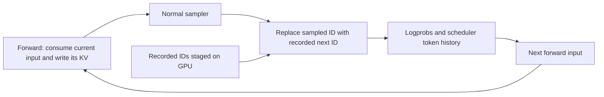

# Token-exact trajectory replay (unofficial)

## Source boundary

The supplied archive identifies source snapshot
`cf2e11e7d1680a9e60faf64d5f6d67b17237e690`. InferenceX's
`infx/bench/agentic/replay.py::replay_argv` assembles an `agentx profile`
command; it does not execute model decoding. Its requirements pin
`agentx-harness==1.0.13`. The matching harness tag resolves to
`60a094f256b42f55fde1efb3d45672e1d9a44566`.

In that harness, `src/aiperf/dataset/loader/weka_trace_models.py` defines
request lengths, block hash IDs, content types, and timing fields. It does
not define original prompt or response token IDs. `weka_synth_buf.py`
reconstructs synthetic content. The `DELTAS_WITH_RESPONSES` context mode
in `src/aiperf/common/enums/enums.py` explicitly discards live responses
when assembling subsequent requests. These sources support the concern
that generated response tokens need not match the next recorded prompt.

The harness also has staged trajectory warmup and optional accelerated
cache-pressure warmup in `src/aiperf/timing/strategies/agentic_replay.py`.
This alone does not establish the meeting's claim of a separate background
thread repairing KV state during measured decoding. Do not remove all
warmup on that assumption: model/CUDA-graph warmup and initializing a
trajectory at a sampled midpoint are distinct from repairing token drift.

## Implementation contract

1. Accept original, tokenizer-specific prompt and response token IDs.
   Preserve full prompt IDs at each turn, including chat-template tokens,
   tool results, and any context truncation. Reject hash-only input for
   token-exact replay; never describe generated filler as recovered text.
2. Carry the expected response IDs to the serving engine once per request.
   Stage IDs before decoding. Replace the sampled ID on-device before
   the scheduler, output bookkeeping, and the following forward pass
   consume it. Keep ordinary model forward and sampling work in the
   benchmark; skipping either changes what is measured.
3. Use the actual decode position rather than a global mutable callback
   counter. Requests can be batched, reordered, paused, and resumed.
   Stop after the recorded response length, including when an internal
   recorded ID is EOS. Validate token IDs against the served vocabulary.
4. Keep unsupported execution modes explicit. Speculative decoding needs
   acceptance and draft-state treatment; ordinary one-token replacement
   must not silently claim speculative support. Log probabilities must
   correspond to the emitted token or the request must reject them.
5. Replay subsequent turns without repair requests. Compare the emitted
   IDs and next-turn cache reuse against a reference run. Preserve
   trace delays and dependencies when integrating the AgentX workload.

For autoregressive decoding, the newly selected token normally has no KV
entry yet; its KV is produced by the next forward pass. Replacing only
the visible HTTP response is too late. Replacing its embedding alone
also leaves scheduler token history and prefix-cache keys inconsistent.
Precomputing embeddings is therefore not a prerequisite: staging token
IDs and using the model's normal embedding lookup preserves the usual
execution path.



Recorded token IDs are not portable across tokenizers. When replaying
text captured from a different model, tokenize it with the served model
before measurement and recompute token counts and shared prefixes. Source
block hashes cannot simultaneously guarantee identical target-token
lengths and preserve the original text. Even with real content, matching
MoE routing across different models is not a valid expectation; the goal
is representative routing for the model being measured.

Token-exact replay fixes the sequence represented by KV entries. It does
not make floating-point KV values or near-tied MoE routing decisions
bitwise identical across batching strategies, kernels, or hardware.

## Verification and evidence still required

- Exercise mixed forced and ordinary requests, batch reorder/removal,
  prompt prefill, EOS, and variable response lengths.
- Run a real model on `gpu6`; compare every emitted ID and next-turn
  prefix reuse. A client mock or a tensor-only test cannot prove this.
- Measure baseline versus forced replay with identical prompt/response
  lengths, concurrency, warmup, and seed 42. Report staging cost separately
  from steady-state decode overhead; do not infer a speedup from correctness.
- Use real-token traces to study MoE expert routing. Hash-derived filler
  cannot establish representative routing or load balance. A dense model
  correctness test does not validate this claim.

## Current implementation and reproduction

The local SGLang checkout at `../sglang` (relative to the InferenceX
repository root) is not required by the regular benchmark client. The
replay engine work targets SGLang **v0.5.10**, commit
`1519acf37c23f2189adb93f57ca9cd2db1bebf18`, matching the initial `gpu6`
installation. `experimental/token_replay/sglang-v0.5.10.patch` is a generated
distribution of that checkout's changes. Apply it to that exact release
with `git apply --check` before `git apply`; later engine releases need a
separate port and serving validation.

`SamplingParams.replay_token_ids` validates vocabulary bounds, output
length, and stopping behavior. The tokenizer rejects speculative,
multimodal, embedding-input, and custom-logit-processor combinations.
`TokenReplayBatch` stages a packed ID buffer at batch admission and keeps
per-request address/length/prompt metadata aligned during filtering and merging. A Triton kernel overwrites
sampled IDs using the actual model position before logprob attachment
and scheduler handoff. No per-token client round trip is introduced.
Token storage is proportional to the sum of recorded response lengths.
Filtering and merging copy only metadata and retain tensor views as owners,
so an admission buffer is released when its last live row and in-flight
batch reference disappear. One short surviving row can retain its entire
admission buffer; no claim of per-request allocation reclamation is made.

The client accepts JSONL with exactly these fields per turn:

```json
{"session_id":"example","input_ids":[1,2],"output_ids":[3,4],"delay_seconds":0}
```

Those IDs illustrate the schema only. Use a trace generated with the
served model's exact tokenizer and chat template. `input_ids` is the full
prompt at each turn. `delay_seconds` is an end-to-start delay (or initial
delay for the first turn). File order defines order within a session.
Different sessions are independent and can overlap; fork/join dependencies
are **not implemented** by this client. It is an unofficial experimental
path, not an AgentX-compatible score submission.

For a patched server configured with `skip_tokenizer_init=True` so it
returns output IDs, run from `inferencex-e2e`:

```bash
python3 -m infx.bench token-replay \
  --url http://127.0.0.1:8000 --trace recorded-trace.jsonl \
  --output replay-results.json --concurrency 1 --timeout 120 --seed 42
```

Server deployment remains the responsibility of `python -m infx.launch`
and its caller-supplied configuration. The client sends no cache-repair
requests, verifies every returned ID, and reports whole-request latency
including prefill. It does not report streaming TTFT or decode-only
throughput. Seed 42 controls configured pseudorandom choices, not OS
scheduling or wall-clock reproducibility.

`experimental/token_replay/check_engine.py` is a real-engine verification
program, not a server launcher. Run it with the patched SGLang importable
and compatible dependencies:

```bash
CUDA_VISIBLE_DEVICES=0 python experimental/token_replay/check_engine.py \
  --model /path/to/model --trace-output recorded-trace.jsonl
```

It checks validation, the GPU replacement kernel, emitted IDs and
logprob IDs, mixed batches, internal EOS, next-turn cache reuse, and
cached-versus-fresh generation. It exports a two-turn model-generated
trace. Its alternating timing samples are a small correctness workload,
not a throughput or MoE load-balance claim.

## Validation status

- Client tests: 8 passed, including real local HTTP transport, exact
  request fields, per-session order, invalid input, and output drift.
- Container-side benchmark tests: 195 passed, 2 skipped.
- InferenceX lint and format checks passed.
- Full macOS suite after restoring the original `srt-slurm` gitlink:
  3201 passed, 19 failed, 2 skipped. Failures involve process-group
  permission restrictions, copied Python executables missing
  `libpython3.12.dylib`, and a CI fixture writing
  `/changelog_metadata.json` on a read-only root filesystem.
- On `gpu6`, vocabulary/stopping validation and the real GPU kernel's
  mixed, reordered, and filtered batches passed.
- The preexisting server environment failed to import `sgl_kernel`:
  PyTorch 2.10.0 did not match SGLang v0.5.10's pinned PyTorch 2.9.1.
  A separate system-site-packages virtual environment now imports the
  kernel with PyTorch 2.9.1+cu128 and matching torchvision/torchaudio.
  Its unchanged cuDNN, cuSPARSELt, and NCCL libraries are linked from the
  original environment so native-library lookup can find them.

Logs are stored under `experimental/token_replay/evidence/` with Git LFS.
Real-engine verification passed on GPU0 (RTX 4090), Qwen2.5-7B-Instruct-GPTQ-Int4,
SGLang 0.5.10, PyTorch 2.9.1+cu128, CUDA toolkit 12.8, seed 42:
24 recorded IDs replayed exactly with their matching logprob IDs; mixed
lengths and internal EOS passed. The next turn reused 34 cached tokens
(required prefix: 33); cached-versus-fresh greedy outputs and logprobs
passed the script's tolerance (0.05 for logprobs). This is behavioral
cache evidence, not a bitwise comparison of KV tensors.

The isolated remote environment is `/home/tegao/infra-token-replay`.
The original serving environment was not modified. CUDA 12.8 was needed
for the GPTQ C++20 JIT; the system CUDA 11.8 could not compile it.
Existing official benchmark recipes remain unchanged. No official AgentX
score, vLLM port, newer SGLang port, or MoE routing result is claimed.


Six measured requests per condition after two warmup iterations gave median
whole-request times of 137.634 ms (ordinary) and 137.833 ms (replay),
a descriptive difference of 0.144%. These short, single-concurrency
requests include prefill and do not isolate staging/kernel overhead or
establish a statistically significant performance effect.

## AgentX harness import

Export token traces to the harness's existing Mooncake raw-payload loader:

```bash
python3 -m infx.bench token-replay \
  --trace recorded-trace.jsonl --output agentx-token.jsonl \
  --seed 42 --agentx-model SERVED_MODEL
```

The patched OpenAI completions endpoint accepts `replay_token_ids` and
forwards it to sampling. The exporter preserves full prompt IDs and response
IDs, converts seconds to Mooncake milliseconds, and requests streaming usage.
Use a tokenizer-enabled server for text streaming; the native ID-checking
client above instead requires `skip_tokenizer_init=True`.

`experimental/token_replay/check_harness.py` passed against the actual
PyPI `agentx-harness==1.0.13` loader: two turns, original token payloads,
750 ms delay, full-history context mode, and no synthetic prompt generation.
This verifies import, not the complete streaming benchmark or an official
AgentX workload score. The exported format currently represents independent
sessions with ordered turns, not fork/join dependencies.

A bounded 65,536-byte range read of the public
`semianalysisai/cc-traces-weka-062126/traces.jsonl` confirmed that the first
request has `t`, `model`, `in`, `out`, `hash_ids`, `api_time`, `type`, and
`ttft`, with no original token IDs. This observation concerns the sampled
prefix only; it is not a full audit of the 1.85 GB corpus. Its hash/length
metadata cannot recover original text or establish representative MoE routing.


## Compact-storage optimization

`profile_replay.py` compares the same seeded mixed-response cases on GPU0.
The padded baseline is retained in `evidence/replay-profile-padded.log`;
the compact result is in `evidence/replay-profile-compact.log`. With 128
requests, one 32K response, other recorded responses of 128 tokens, and
ordinary requests in every fourth row, 44,928 real tokens occupy 359,424
bytes rather than 33,554,432 bytes. The compact metadata adds 3,072 bytes.
Initial staging measured 3.37 ms versus 213.78 ms; median filter measured
15.48 versus 69.71 microseconds, and merge 18.65 versus 252.79 microseconds.
These are synchronized host timings, not device-kernel duration; staging
is a single observation and operation samples are ten groups of twenty
calls after two warmup groups. CPU/launch timing varies between runs.

The 200-round `check_storage.py` test exercises real GPU replacements
through randomized merge/filter/reorder operations, negative and past-end
positions, ordinary rows, int32/int64 sampled outputs, and collection of
filtered-out admission storage (seed 42). It passed. Scheduler overlap
retains the model-worker batch, whose immutable sampling-info copy owns
the replay views; filtering does not mutate an in-flight metadata table.

The compact implementation also passed the real Qwen2.5-7B Int4 engine
check with CUDA graphs and default overlapping scheduling enabled:
24 exact output/logprob token IDs, 34 cached tokens, mixed lengths/internal
EOS, and cached-versus-fresh agreement. See `engine-check-compact.log`.
This rerun confirms the tested behavior after storage changes; it does not
extend coverage to speculative decoding, MoE, or the HTTP streaming path.


## HTTP and device-timing checks

The SGLang patch includes `python/sglang/test/test_token_replay_http.py`,
a real-server unittest fixture. It uses the existing local model and
loopback port, then cleans up its own server process. Set
`REPLAY_TEST_MODEL`, `REPLAY_TEST_URL`, and `CUDA_VISIBLE_DEVICES`, with
the patched package on `PYTHONPATH`, and run the file with the compatible
Python environment. This fixture is independent of InferenceX deployment;
benchmark deployment still uses `python -m infx.launch`.

`experimental/token_replay/profile_kernel.py` requires
`REPLAY_PROFILE_MODULE` (normally `sglang.srt.sampling.token_replay`).
For the padded control, export `sampling/token_replay.py` from SGLang
commit `43bfa5b` as module `replay_padded_baseline`. It verifies replacement
outputs, then measures 100 kernels per CUDA graph with CUDA events, two
warmup graph replays and ten measured replays, at batch sizes 1/32/128/512.
This measures device execution in a graph, not the uncaptured production
host dispatch, and should not be subtracted directly from request latency.


HTTP verification passed: eight requests at concurrency four, each returning
11 recorded tokens over 12 SSE chunks, matching token text/logprobs and
usage counts, followed by exact native output IDs and 18 cached tokens.
The first attempt failed because the new test used OpenAI `seed` inside
native sampling parameters; it was corrected to `sampling_seed`. Both
failure and passing logs are preserved. This is real HTTP/SSE evidence,
not an official AgentX harness benchmark.

CUDA graph device-time medians on RTX 4090 (microseconds per replacement):

| Batch size | Padded | Compact |
| --- | ---: | ---: |
| 1 | 0.992 | 0.983 |
| 32 | 1.085 | 1.096 |
| 128 | 1.137 | 1.155 |
| 512 | 1.154 | 1.167 |

The storage optimization primarily addresses staging and batch mutations;
these measurements do not demonstrate a universal decode speedup.
