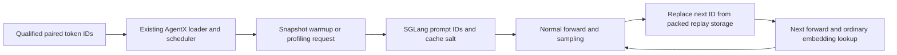

# Engineering Proposal: Recorded-token replay for AgentX

Date: 2026-11-07. Target: engineering PR and bounded technical report. This is a refinement of the delivered implementation, not a new research architecture or a retrospective pre-registration. Follow-up experiments are planned, not executed here.

## Problem Anchor

- Bottom-line problem: Provide an opt-in, reproducible recorded-token path for the existing InferenceX AgentX benchmark, so later recorded prompts can reuse cache corresponding to recorded response tokens while the engine still performs normal forward and sampling.
- Must-solve bottleneck: Response-only replay can return or insert recorded text while the server has computed a different token trajectory; the extension must carry exact token IDs through the supported scheduler, cache-isolation and request lifecycle without silently changing the default benchmark.
- Non-goals: A new determinism algorithm, bitwise equality of floating-point KV tensors across batches, universal speedup, removal of snapshot warmup, reconstruction of original content from hashes, model training, or a top-venue novelty claim.
- Constraints: Engineering PR and technical report first. Reuse this repository's qualified Exgentic/Weka sources, existing Dense/MoE checkpoints and pinned AgentX 1.0.13/SGLang 0.5.10. Seed42; function-scoped code commits; raw execution evidence in Git LFS. Future GPU work requires a fresh resource guard and isolated outputs; GPU1 is outside scope. This pipeline plans follow-up work and does not launch it.
- Success condition: A maintainer can inspect the opt-in API, inherited versus added behavior, exact-ID/lifecycle coverage, declared overhead boundary, default-route regression evidence, reproducible artifacts and honest limitations; each remaining claim has a small falsifiable test and a stopping rule.

## Thesis and contribution

Add an opt-in recorded-token mode to the existing AgentX path: carry paired prompt/response IDs, perform normal forward and sampling, then replace the sampled next ID before the next forward. Preserve the supported scheduler, cache isolation and request lifecycle, and measure the incremental cost separately from cache-reuse effects.

The dominant contribution is the serving/benchmark integration and its reproducible regression contract. The supporting technical report describes bounded cache, phase-cost and MoE observations. Token forcing, teacher forcing, AgentX scheduling, warmup and deterministic kernels are established ideas, not inventions claimed here. No training or new frontier primitive is needed; the model is the workload under test.

The closest alternative is SGLang's existing CustomLogitProcessor, which can force an ID before sampling. That route changes the sampler's input distribution. Post-sampling replacement is selected because the meeting requires normal sampling work to remain. This interface distinction is not evidence of a speed advantage over logit forcing. See the frozen primary-source and evidence ledger in [GROUNDING.md](GROUNDING.md).

## System and complexity budget

1. The token trace uses the existing Weka-shaped schema with paired `input_ids` and `output_ids`, source indices, timing, reset and DAG metadata. Complete prompt IDs bypass template application. Admission rejects invalid pairs and tokenizer/scheduler budget violations. Public hash-only traces retain their default behavior.
2. `AGENTX_TOKEN_TRACE` and `AGENTX_REPLAY_MODE=generated|recorded` select the opt-in path through the pinned patched harness. Local token results remain `submission_valid=false`; the ordinary public path remains available.
3. Existing scheduler, snapshot, warmup, spawn/join and source timing are reused. One-token warmup also truncates replay IDs to one. Tree members share a `cache_salt`; independent tree instances have distinct salts without injecting text into the prompt.
4. The server stages recorded response IDs in packed device storage. Each decode performs ordinary forward and sampling, replaces the selected ID before the next forward and logprob reporting, and carries progress through batch metadata. Filtering/merging avoids copying the packed token payload. The final returned token need not receive a subsequent forward; output length alone does not count actual forwards.
5. Completion, retraction/resume and cancellation must not leave stale replay state. The contract includes these obligations, but evidence supports only paths actually observed. B1 below explicitly targets the remaining retraction/resume and cancellation witnesses.
6. Exact-ID diagnostics and timing evidence have distinct boundaries. Existing HTTP timing obtains native output IDs in every measured response. Existing original-entry acceptance obtains them from engine events. Any future AgentX timing extension must name its symmetric instrumentation; diagnostic-only runs cannot certify unobserved timing runs.

Frozen: models, normal embedding lookup, sampler, inherited scheduler and cache policy. Added: token transport, post-sampling substitution, packed storage and lifecycle metadata. Excluded: new scheduler, embedding precomputation without a measured bottleneck, deterministic kernel suite, expert balancer, trainable controller, full-KV equality requirement and new model campaign.

## Claims

**C1 — supported-path replay correctness:** Admitted recorded-token requests preserve their declared output IDs, salt isolation and ordinary-request behavior across the explicitly tested lifecycle paths. This does not assert bitwise KV equality or untested lifecycle coverage.

**C2 — scoped incremental cost:** Under a declared matched-output and matched-cache-work protocol, replay adds at most 3% end-to-end time at the stated measurement boundary and conditions. Current support is limited to the fixed 32-prompt greedy HTTP experiment; a full AgentX overhead guarantee is not established.

C1 currently rests on the 240-request original-entry witness, the 447-request independent reference, mixed-request checks and one cached-versus-fresh follow-up with output/logprob agreement. The mixed completion fixture does not establish cancellation cleanup. Pressure-run retraction counters do not establish exact-ID continuity for a particular resumed request. Those paths remain explicitly unverified pending B1.

C2 currently has adjusted upper HTTP interval bounds of 0.8150%, 0.3886% and 0.6693% at concurrency 1, 4 and 8. These concern fixed prompts, greedy generation, matched returned IDs/cache work, prewarmed execution and zero retractions. They do not cover every sampling policy, workload, first-use cost or the original AgentX scheduler boundary.

Rejected inferences: exact returned IDs prove universal numerical KV equality; a cache-hit improvement equals proportional throughput gain; a source-row count equals profiling invocation coverage; warmup is free or eliminated; MoE routing differences establish GPU-time differences; matched counters prove identical internal computation.

## Existing result and deletion control: B0

Reuse the completed delivery at InferenceX `c2e804c4523d73162018fac18850f62a806387b2`, harness `b9772d220f86322055680a28736958c9f5b1fe4c` and SGLang `d611ff2171e95a88e6aac7c5b24cc224a3b5bbd5`. Raw evidence is retained in Git LFS. The [meeting report](../inferencex-e2e/docs/token-replay-meeting-review.md) and [reproduction guide](../experimental/token_replay/README.md) are the result and environment authorities.

The 36-point Dense study completed 25,755 profiling and 1,716 warmup requests with zero errors. Roomy-cache standardized reuse improves about 1.65–1.66 percentage points; throughput point changes are +0.0882%, +0.5689% and +0.8466%. Pressure c4/c8 throughput intervals span zero. The generated-versus-recorded comparison deletes substitution and measures its workload/cache consequences; it is not a matched-work estimate of replacement overhead.

The 37-run phase audit establishes that warmup HTTP requests finish before profiling, while warmup still consumes time and prefill work. It does not establish GPU-event non-overlap, equivalence to full history, or elimination of warmup interference. The MoE real/synthetic study shows different routing distributions but no established throughput separation: +0.2336%, interval [-0.0285%, +0.4958%]. Recorder costs and the 9/308 representative rank-timing coverage stay visible. There is no reason to repeat these campaigns for this planning task.

## Sole recommended pre-merge addition: B1

Extend the existing lifecycle fixture to bind an observed retraction and later resume to the same replay request. Check the final complete ID sequence and the continuation position after resume. A small diagnostic observer and dedicated driver still need implementation and review; current per-request retraction counters alone cannot prove the event chain. Exercise unequal reply lengths through filtering/merging, mixed ordinary/replay traffic, and one cancellation followed by an ordinary request and a fresh replay request. Distinguish cancellation before completion from a completed request that merely disconnects afterward. Pin incremental_streaming_output=false, validate cumulative nonterminal packets, and handle terminal abort receipts separately: their output_ids may contain only the last token while completion_tokens counts the retained prefix. Use the same RID, prefix/progress events and abort terminal status; do not interpret the singleton as restarted replay.

Freeze expected IDs, source rows, salts and source/model versions. Use the existing safe Dense capacity 131072, context 16384, max-running-requests 16 and CUDA graph maximum batch 16. Set SGLANG_TEST_RETRACT=true, SGLANG_TEST_RETRACT_INTERVAL=3 and SGLANG_TEST_RETRACT_NO_PREFILL_BS=2147483648: this invokes the same batch.retract_decode() used for KV exhaustion. Begin with c4 and permit one predeclared c8 escalation at unchanged capacity. This is test-triggered lifecycle evidence, not natural-pressure frequency or performance evidence. Require observed events, not a configuration label. At most two 600-second control windows inside 0.5 GPU-hours total including startup/drain/cleanup; no retraction observed means UNCOVERED, not PASS. A correctness mismatch is FAIL and stops the run. Inspect existing output/logprob/cache witnesses first; cutpoint or numerical KV diagnostics are optional on a mismatch, not a universal prerequisite. Any lifecycle fix is function-scoped and triggers focused re-review and regression.

## Conditional claim expansion: B2, deferred

B2 is not a pre-merge requirement for the current scoped report. Activate it only if an AgentX-boundary C2 claim is needed, after a separate CPU gate and protocol freeze. It does not inherit execution readiness from this document.

- Use four fixed qualified source sessions and exactly four profiling root admissions, including roots already active at snapshot handoff. Warmup occurrences are separate ledger entries. Verify existing finite-session stop/drain behavior and minimally forward its configuration through the original wrapper. Do not substitute a request-count cap or replace the scheduler.
- A snapshot-resumed root counts once, its tail drains, no replacement is admitted beyond the cap, and sent equals completed with zero errors/cancellations/pending work. A duration/watchdog stop before cohort completion invalidates the run. Complete branch drain is required for any claimed DAG support; otherwise label this subset as sequential-session only.
- Keep prompt IDs, output budgets, source identities, timestamps and scheduling metadata fixed. Capture normal greedy outputs once, freezing a single output vector per source row. Every repeated occurrence must agree, and every one-token warmup must match the same vector's prefix. Rows never observed in full profiling cannot supply an overhead reference. No recapture until matching, cohort substitution, later-prompt rewriting or occurrence-specific interface is permitted within this plan.
- Match by phase, source identity, logical tree/root occurrence, turn and reset ordinal. Compare salt equivalence classes, not random UUID strings. Source-row output IDs do not support occurrence-specific different responses. If replay and generated ledgers or outputs differ, stop B2 and retain all mismatches.
- `/v1/completions` does not expose native output IDs. Use the same existing engine request-finished output-ID instrumentation in capture and both timed arms; freeze its configuration and completeness checks. Report an **instrumented AgentX** boundary. Do not claim diagnostic-free full-AgentX cost from those runs. If symmetric observable IDs cannot be collected or mapped, B2 remains deferred and C2 retains HTTP scope.
- Require equal per-invocation prompts, output IDs/lengths, cache-work counters, invocation ledgers and zero retractions/cancellations. Such matching is an observable-work contract, not proof of identical internal GPU computation. Start at c1 only; c8 is a separate future scope and cannot inherit the result.
- One calibration pair, excluded from inference, determines whether the frozen cohort fits the all-inclusive 1.5 GPU-hour c1 ceiling. Include capture, startup, warmup, measurement, drain and calibration. Three alternating measurement pairs initially; only an interval containing or touching 3% expands directly to five under the existing two-look adjusted Student t rule. If the remaining budget cannot finish the required look, report INCOMPLETE without a positive extension; reserve INCONCLUSIVE for a completed five-pair interval still crossing the target, and DEFERRED for insufficient predicted budget before measurements. Do not shrink the cohort after results.

## Planning gate and handoff

Thesis and dominant contribution are stable. No new frontier primitive is needed. B0 supplies the main result and mechanism-deletion evidence; B1 is the sole recommended pre-merge evidence addition. B2 is a deferred claim expansion with explicit activation gates. The remaining issues concern lifecycle coverage, optional measurement feasibility and missing Claude review, not a new architecture.

All follow-up work uses seed 42 and repository-supported data, GPU0 only after a fresh resource guard, isolated outputs and Git LFS raw logs. No GPU work is launched in this pipeline. The plan and tracker separate completed B0, TODO B1 and deferred B2. The method review is Codex-only provisional until the missing independent Claude review is available; no score can substitute for the empirical gates.
